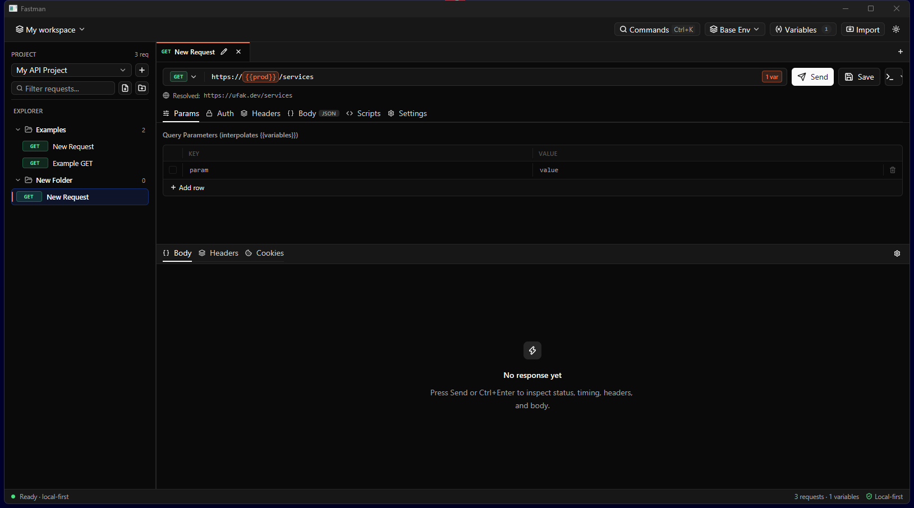

# Fastman

**A native, local-first API client for building and sending HTTP requests, written in Rust with GPUI Kit.**

> Status: **v0.3.0**, an early open-source preview. Expect rough edges and breaking changes before 1.0. See the [changelog](CHANGELOG.md).



Fastman is for developers who want a fast desktop API client that keeps everything local:

- **Native UI.** Built on GPUI Kit, with no Electron or embedded browser.
- **Local-first.** Projects are stored as plain JSON on your machine. Fastman sends network traffic only when you send a request.
- **No account, cloud sync, ads, or telemetry.**
- **Safe by default.** TLS verification is on by default. Imported collections and scripts are never executed, and credentials are redacted when you copy a request as cURL.
- **Desktop app and CLI.** Both use the same project files.

## Download

Prebuilt binaries are published on [GitHub Releases](https://github.com/EmirUfak/fastman/releases).

| Platform | Binary | Notes |
|---|---|---|
| Windows x86_64 | Yes | Portable executables; no installer. |
| Linux, macOS | No | Build from source; see [Platform support](#platform-support). |

- **Releases from the [release workflow](.github/workflows/release.yml) (`v0.3.0+`)** ship `fastman-<tag>-x86_64-pc-windows-msvc.zip`. It contains `fastman-desktop.exe`, `fastman-cli.exe`, `LICENSE`, and `README.md`, along with a `.sha256` checksum file. (`v0.2.1` shipped only the desktop executable.)
- **The binaries are not code-signed**, so Windows SmartScreen may warn you the first time you run them. You can check the download against the published SHA-256 checksum when one is provided:

  ```powershell
  Get-FileHash .\fastman-<tag>-x86_64-pc-windows-msvc.zip -Algorithm SHA256
  ```

## Quick start (from source)

1. **Install the prerequisites:**
   - Rust stable `>= 1.100` via [rustup](https://rustup.rs). The repository's `rust-toolchain.toml` selects the stable channel.
   - The native build prerequisites for GPUI on your OS. GPUI Kit is built on Zed's GPUI, so follow Zed's per-OS guides: [Windows](https://github.com/zed-industries/zed/blob/main/docs/src/development/windows.md), [Linux](https://github.com/zed-industries/zed/blob/main/docs/src/development/linux.md), [macOS](https://github.com/zed-industries/zed/blob/main/docs/src/development/macos.md). On Windows, that means Visual Studio or Build Tools with the **Desktop development with C++** workload (MSVC and the Windows SDK).
2. **Clone the repository and run the app:**

   ```sh
   git clone https://github.com/EmirUfak/fastman.git
   cd fastman
   cargo run --release -p fastman-desktop
   ```

3. **Send your first request.** On first launch, Fastman creates an empty project named **My API Project**. Create a request, enter a URL such as `https://httpbin.org/get`, and click **Send**.

To test and lint core and CLI without a GUI toolchain, run `cargo test-core` and `cargo lint-core`; see [CONTRIBUTING.md](CONTRIBUTING.md#local-checks) for all check aliases.

## Platform support

| Platform | Status |
|---|---|
| Windows x86_64 | **Tested.** CI runs format, Clippy, tests, and a release build on every push. Release binaries are Windows-only. |
| Linux | **Untested.** `fastman-core` and `fastman-cli` have no GUI dependencies and are expected to build. The desktop app depends on GPUI's Linux support. |
| macOS | **Untested.** Same as Linux. |

Reports from Linux and macOS builds are welcome. Please open an issue with your OS, architecture, and build output.

## Usage

### Desktop

- The header selects the active **workspace**. Use **+ Workspace** to create one. Each workspace has its own projects, and existing projects stay in **My workspace**.
- The left panel has the project selector and a collection/folder/request explorer with search, context menus, and drag-and-drop.
- Request tabs edit the method, URL, Params, Auth, Headers, Body, and Settings. Use **Send**, **Cancel**, and **Save**.
- `Ctrl+K` (`Cmd+K` on macOS) opens the command palette for projects, collections, requests, and common actions.
- Import a Collection v2.1 JSON file or paste a cURL command. Use **Copy as cURL** to export a request with secrets redacted by default.

### CLI

The CLI works only with the default workspace. From a source checkout, run:

```sh
cargo run -p fastman-cli -- --help
cargo run -p fastman-cli -- list
cargo run -p fastman-cli -- import-collection ./my_collection.json
cargo run -p fastman-cli -- send [--raw] [--env <name-or-id>] <project-uuid> <request-uuid>
```

Importing a collection creates a new project and never runs any requests or scripts. If the collection contains secrets, you must pass either `--strip-secrets` or `--allow-plaintext-secrets`. Terminal control characters in output are escaped unless you pass `send --raw`.

### Where data is stored

Each project is a JSON file (`schema_version = 1`) in the OS local data directory, or in `FASTMAN_HOME` if that is set. `Auth` credentials are kept in memory only, `Secret` variables are stored in the OS credential store (Windows Credential Manager, macOS Keychain, or Linux `secret-tool`), and `Env` variables read process environment variables at runtime. **Custom headers, query params, bodies, and plain variable values *are* saved to disk**, so don't put secrets in them. See [SECURITY.md](SECURITY.md#security-model--known-caveats).

## Features

| Area | Desktop | CLI |
|---|---|---|
| Workspaces and projects | Create and switch; project environments and typed `Plain` / `Secret` / `Env` variables | Default workspace only (`list`, `send --env`) |
| Explorer | Virtualized nested folders, search, context menus, drag-and-drop | — |
| Request editor | Method, URL with variable highlighting, params, headers, auth, body (JSON validation and formatting), timeout, per-request TLS verification opt-out | — |
| Request execution | Async, cancellable; same-origin redirects only (max 10); 100–300,000 ms timeout; 2 MiB response cap | `send` |
| Response viewer | Status, TTFB/download/total timing, size, final URL, searchable pretty or raw body, headers, cookies, persistent panel placement | Status, TTFB/download/total timing, escaped text output |
| Command palette | `Ctrl+K` / `Cmd+K` fuzzy search across requests, folders, projects, workspaces, environments, and actions | — |
| Collection v2.1 JSON import (subset) | Yes | `import-collection` |
| cURL import | Yes (file `@path` arguments rejected safely) | — |
| Copy as cURL (redacted by default) | Yes | — |

## Current limitations

The following are **not implemented yet**:

- **Requests:** OAuth 2.0, Digest, and AWS SigV4 auth; multipart and binary uploads; proxy and client-certificate configuration.
- **Protocols:** GraphQL tooling, WebSocket, gRPC, and SSE.
- **Automation:** request tests and assertions. Fastman will never run JavaScript. A collection runner is also missing.
- **Data:** collection export, request history, and streaming for large responses.
- **Distribution:** installers, code signing, and Linux/macOS binaries.

## Repository layout

```text
apps/fastman-desktop/   GPUI workbench: explorer, request and response views
apps/fastman-cli/       Headless list, import, and send
crates/fastman-core/    GUI-free domain model, storage, HTTP, templates, import, and cURL
.cargo/                 Shared Cargo aliases for formatting, lint, test, and check commands
.github/                CI, release workflow, and issue/PR templates
```

## Contributing and community

- [Contributing guide](CONTRIBUTING.md): workflow, checks, and engineering rules
- [Security policy](SECURITY.md): report vulnerabilities privately, not in public issues
- [Changelog](CHANGELOG.md)

## License

Fastman is licensed under the [MIT License](LICENSE). GPUI Kit and other third-party dependencies are covered by their own licenses.
